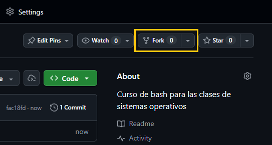
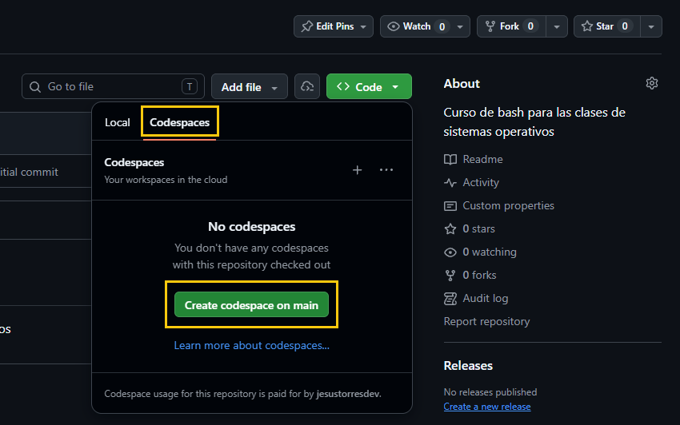
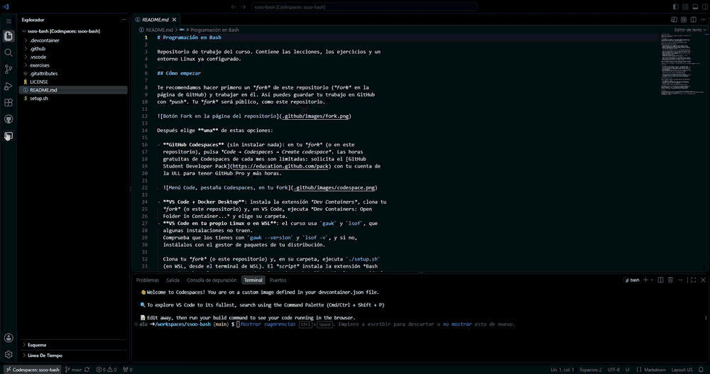

# Programación en Bash

Repositorio de trabajo del curso. Contiene las lecciones, los ejercicios y un
entorno Linux ya configurado.

## Cómo empezar

Te recomendamos hacer primero un *fork* de este repositorio (*Fork* en la
página de GitHub) y trabajar en él. Así puedes guardar tu trabajo en GitHub
con *push*. Tu *fork* será público, como este repositorio.

Después elige **una** de estas opciones:

- **GitHub Codespaces** (sin instalar nada): en tu *fork* (o en este
  repositorio), pulsa *Code → Codespaces → Create codespace*. Las horas
  gratuitas de Codespaces de cada mes son limitadas: solicita el [GitHub
  Student Developer Pack](https://education.github.com/pack) con tu cuenta de
  la ULL para tener GitHub Pro y más horas.

  

- **VS Code + Docker**: instala la extensión *Dev Containers*, clona tu
  *fork* (o este repositorio) y, en VS Code, ejecuta *Dev Containers: Open
  Folder in Container...* y elige su carpeta.
- **VS Code en tu propio Linux o en WSL**: el curso usa `gawk` y `lsof`, que
  algunas instalaciones no traen.
  Comprueba que los tienes con `gawk --version` y `lsof -v`, y si no,
  instálalos con el gestor de paquetes de tu distribución.

  Clona tu *fork* (o este repositorio) y, en su carpeta, ejecuta `./setup.sh`
  (en WSL, desde el terminal de WSL). El *script* instala la extensión
  *Course Lab* y abre el curso en VS Code. Si no tienes `shellcheck`, la
  extensión lo descarga al arrancar (o ejecuta `.course/check/bin/check --setup`).

Con el curso abierto, pulsa el icono **Course Lab** de la barra de actividades
para ver el curso. Si no aparece y no usas un contenedor, ejecuta `./setup.sh`.

## Ejercicios

- Tus ficheros están en la carpeta `exercises/`: una carpeta por semana
  (`exercises/s03`), donde se abre el terminal, y una dentro de ella por cada
  ejercicio de *script*. Se crean la primera vez que abres cada página.
- La vista **Ficheros**, bajo **Referencia**, muestra los datos y el *script*
  de la página abierta.
- Pulsa **Comprobar ejercicio** o ejecuta `check` en el terminal, dentro de la
  carpeta del ejercicio, para ver si tu script supera las pruebas.

  

- `check mi_script.sh` revisa cualquier script con *shellcheck*.
- Tu progreso se guarda en `.course-lab/progress.json`. Haz *commit* a menudo
  y, si trabajas en tu *fork*, *push* para no perderlo. Recuerda que un
  *codespace* que no uses en 30 días se borra con lo que no hayas subido.

## Actualizaciones del curso

Puede que tengamos que publicar correcciones durante el curso. Para tenerlas:

1. Haz *commit* de tu trabajo.
2. En la página de tu *fork* en GitHub, pulsa *Sync fork → Update branch*.
3. En VS Code, en la vista *Control de código fuente*, pulsa *Sincronizar
   cambios* (o ejecuta `git pull` en el terminal).

Si no hiciste *fork* y clonaste este repositorio, basta con el paso 3.

Las carpetas `exercises/` y `.course-lab/` no están en este repositorio, así
que una actualización no toca tus ejercicios ni tu progreso. En cambio, si
modificas ficheros de `course/`, la actualización puede dar conflictos.
Por tanto, no los edites. La extensión *Course Lab* se actualiza sola.

## Licencia

El contenido del curso, en `course/`, es de Jesús Torres (Universidad de La Laguna) y se
distribuye bajo la licencia [Creative Commons Atribución 4.0 Internacional](https://creativecommons.org/licenses/by/4.0/deed.es)
(CC BY 4.0), cuyo texto está en `course/LICENSE`.
El código, como `setup.sh` y el corrector de `.course/check/`, se distribuye bajo la
licencia MIT, en `LICENSE`.
