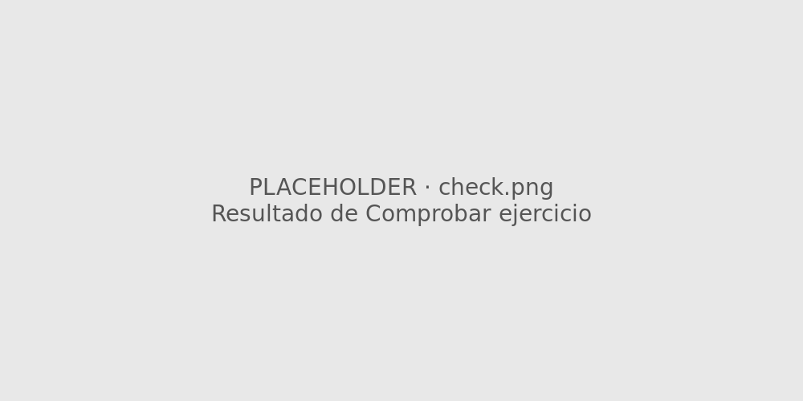

El curso tiene dos clases de ejercicios: los retos, que se hacen en la terminal, y los ejercicios de *script*.

## Los retos

Cada reto de un comando pide predecir qué hace una orden, probar una opción o combinarlo con otros comandos.
Los de predecir y los que tienen una respuesta exacta, como un número, se responden en la propia página, que indica si la respuesta es correcta.
Los demás llevan la solución en un desplegable cerrado: resuélvelos antes de abrirlo, y compara.
Cuando termines los retos, pulsa *Marcar como completado*.

## Los ejercicios de *script*

Un **ejercicio de *script*** pide escribir un *script* que hace algo concreto con los datos de la semana.
Son el *script* de cada semana y los de la lección «Ejercicios».

Al abrir uno, se abre un archivo de *script* vacio en el editor y una terminal en su directorio:

1. **Prográmalo** debajo del último comentario.
2. **Pruébalo** en la terminal con distintos argumentos, como `bash ver.sh notas.csv`, también con nombres con espacios y con ficheros que no existen.
3. **Compruébalo** con el botón *Comprobar ejercicio* de la página, con el icono del matraz, arriba a la derecha del editor, o ejecutando `check` en la terminal.

La comprobación tiene dos partes:

- ***shellcheck*.** Revisa el *script* en busca de errores frecuentes, como una variable sin comillas. Los que encuentre harán fallar el ejercicio, mientras que las sugerencias de estilo salen bajo «Avisos» y no lo hacen fallar.
- **Pruebas.** Ejecutan tu *script* sobre una copia nueva de los datos y comprueban su salida, los ficheros que crea y su estado de salida.
  El nombre de cada prueba dice qué se espera; si falla, debajo aparece lo que se esperaba y lo que se ha obtenido, y a veces una pista sobre la causa.

El ejercicio se completa cuando supera todas las comprobaciones.
Mientras tanto, el árbol muestra junto a él cuántas superó la última vez, por ejemplo: `3/7`.

Como las pruebas usan una copia nueva de los datos, tu *script* puede crear, mover o borrar ficheros sin que eso afecte a la comprobación.
Si quieres empezar de cero, pulsa con el botón derecho sobre el ejercicio en el árbol y elige *Restablecer ficheros del ejercicio*: vuelve el *script* inicial y los datos, y pierdes los cambios que hayas hecho en ellos.
