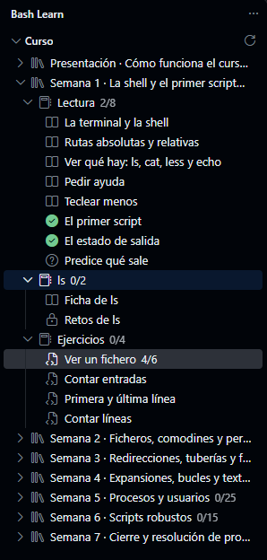

Cada sección del curso es de uno de cuatro tipos.
El árbol los distingue por el icono, y cada uno se completa de una manera distinta:

| Tipo                 | Qué haces                                   | Se completa cuando…                         |
|----------------------|---------------------------------------------|---------------------------------------------|
| Teoría               | Lees y pruebas los ejemplos                 | llegas al final de la página                |
| Cuestionario         | Respondes unas preguntas                    | todas las respuestas son correctas          |
| Práctica en terminal | Resuelves retos en la terminal              | pulsas *Marcar como completado*             |
| Ejercicio de *script* | Escribes un *script*                       | supera todas las comprobaciones             |


Las secciones completadas llevan una marca verde en el árbol, y una semana o una lección se marca cuando lo están todas sus secciones.
Una sección con un candado depende de otra que aún no has completado, como los retos de un comando, que recomiendan que primero hayas completado su ficha.
Puedes abrirla igualmente: la página empieza con un aviso «Antes de empezar» que enlaza a las secciones que conviene hacer antes.



## La terminal del curso

Las secciones que lo necesitan abren una terminal en el directorio de su semana, como `exercises/s03` en la semana 3.
Los bloques de código tienen dos botones: *Ejecutar en terminal*, que envía las órdenes a esa terminal, y *Copiar*.
Pruébalo con este:

```bash
echo "Hola desde la terminal del curso"
```

En los ejemplos que muestran una orden y su salida, el botón solo envía las líneas que empiezan por `$`.
Si un bloque tiene varias órdenes, cada una tiene además su propio ▶ a la izquierda, para ejecutarlas de una en una.

## Los datos de cada semana

Cada semana trabaja con unos ficheros de datos, como `notas.csv` o `acceso.log`, que se copian en su directorio la primera vez que abres una de sus partes.
Los ejemplos de la lectura, las fichas y los retos usan esos mismos ficheros, así que puedes repetirlos y cambiarlos.

El contenido que ya está en tu directorio nunca se sobrescribe.
Si estropeas un fichero de datos, bórralo y vuelve a abrir la sección: se copia de nuevo.

## Tu progreso

Lo que completas, las respuestas de los cuestionarios y el resultado de la última comprobación de cada ejercicio se guardan en `.bash-learn/progress.json`, dentro de tu repositorio.
Haz *commit* a menudo, junto con tus ejercicios, para no perderlo.
