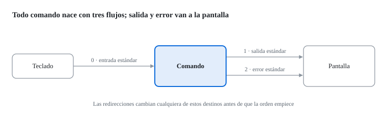

Cuando `ls` lista un directorio, el resultado aparece en la pantalla.
Cuando falla, el mensaje de error también.
¿Son la misma cosa?
No, y esa diferencia es la que nos va a permitir separar los resultados de los mensajes de error.

Los **flujos estándar** son los tres canales que todo proceso tiene abiertos al empezar, cada uno identificado por un número llamado descriptor de fichero:

- **Entrada estándar (0).**
  De donde lee los datos.
  Por defecto, el teclado.
  Si un comando está leyendo del teclado, como `cat` sin argumentos, [[Ctrl]]+[[D]] le indica que no hay más datos.
- **Salida estándar (1).**
  A donde escribe los resultados.
  Por defecto, la pantalla.
- **Error estándar (2).**
  A donde escribe los mensajes de error y los avisos.
  Por defecto, también la pantalla.

Que salida y error vayan al mismo sitio es solo el comportamiento por defecto.
Las redirecciones nos permiten mandar cada uno a un destino distinto.
