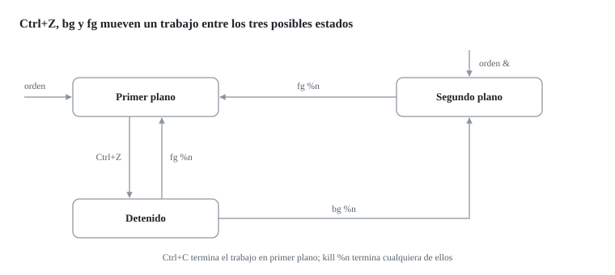

Mientras un comando largo se ejecuta, la terminal queda ocupada.
¿Podemos seguir trabajando sin abrir otra?

Un **trabajo** es una orden lanzada desde la *shell* actual, que la *shell* numera y controla.
En cada terminal solo un trabajo puede estar en primer plano, recibiendo lo que tecleamos.
El resto puede estar en segundo plano o detenido.

- **`orden &`.**
  Lanza la orden directamente en segundo plano.
- **[[Ctrl]]+[[Z]].**
  Detiene el trabajo en primer plano.
- **`jobs`.**
  Lista los trabajos de la *shell* con su número.
- **`bg %n`.**
  Reanuda en segundo plano el trabajo detenido número n.
- **`fg %n`.**
  Trae el trabajo n al primer plano.
- **`kill %n`.**
  Envía una señal al trabajo n sin necesidad de conocer su PID.



```console
$ sleep 300 &
[1] 4821
$ jobs
[1]+  Ejecutando              sleep 300 &
$ fg %1
sleep 300
^Z
[1]+  Detenido                sleep 300
$ bg %1
[1]+ sleep 300 &
$ kill %1
```

El número entre corchetes es el del trabajo y el otro, el PID.
En tu máquina estos números serán distintos.
Los trabajos pertenecen a la *shell* que los lanzó; por eso, desde otra terminal no aparecen en `jobs`, aunque sí en `ps`.
